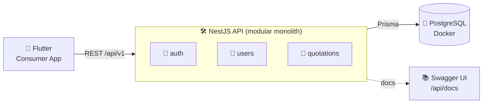

<div align="center">


<a href="https://git.io/typing-svg">
  
</a>

<br/>


</div>

---

> [!WARNING]
> 🚧 **This is a starter, not a production system.** It is **not ready** to handle real customer or financial data. See [Before going to production](#-before-going-to-production) for what's still missing.

## 📖 Table of Contents

- [✨ What is this?](#-what-is-this)
- [🏗️ Architecture](#️-architecture)
- [🧰 Tech Stack](#-tech-stack)
- [📂 Project Structure](#-project-structure)
- [🚀 Quick Start](#-quick-start)
- [⚙️ Configuration](#️-configuration)
- [🧪 Scripts & Commands](#-scripts--commands)
- [🔌 API Overview](#-api-overview)
- [🛡️ Before going to production](#️-before-going-to-production)
- [🗺️ Roadmap](#️-roadmap)

---

## ✨ What is this?

A monorepo starter for a **personal-loan quotation app** 💸. A customer fills in a loan request on a mobile app, and the backend stores it as a **draft quotation** that can be updated, submitted or cancelled.

| 📱 Consumer app | 🛠️ Backend API | 🐘 Database |
|:---:|:---:|:---:|
| Flutter | NestJS (TypeScript) | PostgreSQL + Prisma |
| Quotation journey for customers | JWT auth with refresh-token rotation | Dockerized, persisted in a named volume |

**Highlights**

- 🧩 **Modular monolith**: one deployable API with clear domain modules (`auth`, `users`, `quotations`) that can be split into services later
- 🔐 **Secure-by-default auth**: JWT access tokens plus rotating refresh tokens
- 📚 **Swagger UI** for exploring the API
- 🤖 **CI ready**: GitHub Actions for backend, Flutter and Firebase App Distribution
- 🧑‍💻 **Dev-friendly**: shared VS Code settings and recommended extensions

---

## 🏗️ Architecture



---

## 🧰 Tech Stack

| Layer | Technology |
|---|---|
| 📱 **Frontend** | Flutter |
| 🛠️ **Backend** | NestJS (TypeScript), JWT auth with refresh-token rotation |
| 🐘 **Database** | PostgreSQL, managed with Prisma |
| 🐳 **Infrastructure** | Docker Compose with a named volume for persistence |
| 📚 **API docs** | Swagger UI |
| 🤖 **CI/CD** | GitHub Actions (backend CI with Postgres service container, Flutter CI, Firebase App Distribution) |
| 🧑‍💻 **Tooling** | VS Code with recommended extensions and shared settings |

---

## 📂 Project Structure

```text
personal-loan-monorepo/
├── 🤖 .github/workflows/     # CI pipelines
├── 🧑‍💻 .vscode/              # Recommended extensions & settings
├── 📱 apps/
│   └── consumer_app/         # Flutter application
├── 🛠️ backend/                # NestJS API
│   ├── prisma/               # Schema, migrations, seed
│   └── src/
│       ├── auth/             # 🔐 Authentication
│       ├── users/            # 👤 Users
│       ├── quotations/       # 📝 Quotations
│       └── infrastructure/
│           └── database/     # 🐘 Prisma connection
├── 🐘 database/              # Database initialization guide
├── 📚 docs/                  # Documentation (incl. legacy mapping doc)
├── 🧰 scripts/               # Flutter check scripts (.sh / .ps1)
├── .env.example
├── docker-compose.yml
└── README.md
```

---

## 🚀 Quick Start

You'll bring up three things: the **database**, the **backend**, then the **Flutter app**.

### 1️⃣ Start PostgreSQL 🐘

From the **repo root**:

```bash
cp .env.example .env
docker compose up -d postgres
docker compose ps        # check it's healthy
```

> PostgreSQL will be available on `localhost:5432`.

### 2️⃣ Start the backend 🛠️

From `backend/`:

```bash
cp .env.example .env
npm install
npm run prisma:generate
npm run db:migrate
npm run db:seed
npm run start:dev
```

| What | Where |
|---|---|
| 🌐 API | `http://localhost:3000/api/v1` |
| 📚 Swagger UI | `http://localhost:3000/api/docs` |

> [!NOTE]
> Swagger is disabled in production unless you set `SWAGGER_ENABLED=true`.

### 3️⃣ Start the Flutter app 📱

From `apps/consumer_app/`:

```bash
flutter pub get
dart run build_runner build --delete-conflicting-outputs
cp env/dev.example.json env/dev.json
flutter run --dart-define-from-file=env/dev.json
```

> [!TIP]
> If the platform folders (`android/`, `ios/`, ...) are missing, generate them first with `flutter create .`

---

## ⚙️ Configuration

Backend variables live in `backend/.env`:

| Variable | Description |
|---|---|
| `DATABASE_URL` | 🐘 PostgreSQL connection string |
| `JWT_ACCESS_SECRET` | 🔑 Secret used to sign access tokens |
| `JWT_ACCESS_TTL` | ⏱️ Access token lifetime |
| `PORT` | 🔌 Port the API listens on |
| `CORS_ORIGIN` | 🌍 Allowed browser origin(s) |

> [!CAUTION]
> 🔒 Never commit real credentials. Use a **secret manager** in production.

---

## 🧪 Scripts & Commands

| Command | What it does |
|---|---|
| `npm run db:migrate` | ▶️ Apply migrations locally (creates the `init` migration on first run) |
| `npm run db:seed` | 🌱 Load safe development seed data |
| `npm run db:reset` | 💥 **Deletes all local database data.** Never run against production |
| `npm run db:deploy` | 🚢 Apply committed migrations (production) |
| `scripts/check-flutter.sh` / `.ps1` | ✅ Run the same Flutter checks locally as CI |

> [!IMPORTANT]
> Don't use `prisma db push` for production deployments. Use `db:deploy` with committed migrations.

---

## 🔌 API Overview

All routes are under `/api/v1`. Open **Swagger UI** for the full, interactive reference. 📚

| Area | Endpoints |
|---|---|
| 💚 **Health** | `GET /health` |
| 🔐 **Auth** | register, login, refresh, logout |
| 👤 **Users** | `GET /users/me` |
| 🏷️ **Products** | list active products, get a product by code |
| 📝 **Quotations** | create, list, get, update sections, submit, cancel |
| 📎 **Documents** | upload, list, download, cancel |

<details>
<summary>📦 <b>Quotation request sections</b> (click to expand)</summary>

<br/>

The quotation request shape has changed, and any old example payload is outdated. The current sections are:

- 🙋 `applicant`
- 🏠 `addresses`
- 💼 `occupations`
- 💰 `loanRequest`
- 🚗 `vehicle`
- 👥 `persons`
- ✅ `consents`

</details>

---

## 🛡️ Before going to production

The API currently **only creates draft quotations**. It does **not** do credit scoring, eligibility checks, approvals or disbursements.

Before handling real customer data, you'll need at least:

- [ ] 🪪 Identity verification
- [ ] 🚦 Rate limiting
- [ ] 🔐 Multi-factor authentication (MFA)
- [ ] 🧾 Audit logs
- [ ] 🗄️ Secure document storage
- [ ] 📜 Consent management
- [ ] ⚖️ Security and legal review

---

## 🗺️ Roadmap

- [ ] 🔐 Finish authentication and authorization
- [ ] ✏️ Add draft update and submit endpoints
- [ ] 🏷️ Add product configuration APIs
- [ ] ☁️ Integrate object storage for documents
- [ ] 📜 Add consent versioning
- [ ] 🤖 Set up CI checks and a staging environment

---

<div align="center">

**Built with ☕ and 💙**


</div>
